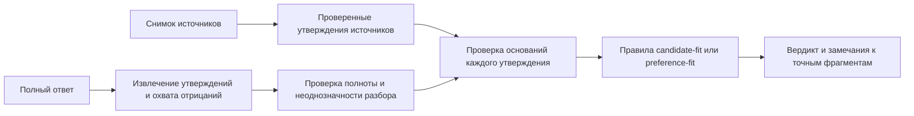

# V3: проверка утверждений и границ доказательств

12 октября 2026. Статус: **проект, без реализации и прогона v3**. Все примеры
разобраны вручную по локальным синтетическим материалам v2. Это известные
разработчику примеры, не новая контрольная выборка. Эталон v2 предложен агентами,
не утверждён человеком. Offline; без API, установок, коммитов и push.

## Решение

Сохранить два назначения: **candidate-fit** проверяет доказательность оценки
опыта относительно JD; **preference-fit** проверяет соответствие условий роли
зафиксированным предпочтениям кандидата. Общий механизм v3 проверяет отдельные
утверждения. Он не оценивает вероятность интервью и не относится к отдельному
инженерному benchmark надёжности сервиса.

Первый полезный этап — проверка типизированных утверждений, разобранных и
проверенных вручную. Автоматическое извлечение из произвольного текста — отдельная
нерешённая задача. Перенос ответа в JSON сам по себе не делает его понимание
правильным. В этом проекте нет предположения о доступной локальной модели.

Источники нормализуются до чтения оцениваемых ответов. Разбор ответа не получает
ожидаемый вердикт, мутацию, результаты v2 или `gold.allowed_labels`. Проверяющий
получает источники, проверенный разбор и общие правила; эталонные ответы остаются
в измерительном контуре. На нынешних известных примерах слепоту восстановить
невозможно — это ограничение следует записать, а не маскировать новой фиксацией.

## Что меняется относительно v2

На новых 52 ответах v2 принял 21/26 ошибочных и отклонил 2/26 допустимых.
Ещё один ошибочный ответ был отклонён за правильный, неизменённый фрагмент:
содержательно обнаружены 4 дефекта из 26, при 5 формальных отказах.
Основание: [ANALYSIS.md](../career-quality-v2/ANALYSIS.md) и
[review/results_review.json](../career-quality-v2/review/results_review.json).

Совпадения меток, source IDs и цитат недостаточно. Из правильной цитаты может
следовать неправильный вывод; правильное ограничение в одном поле не отменяет
необоснованную гарантию в другом. Вместо расширения списка английских шаблонов
v3 должен проверять направление вывода и точно показывать, где оно нарушено.

## Минимальный контракт утверждения

Каждое атомарное утверждение содержит следующие поля. Пустое значение означает
неизвестность, а не глобальный охват или отсутствие ограничения.

| Поле | Что фиксируем | Зачем |
| --- | --- | --- |
| `anchor` | Хеш файла, JSON Pointer, точный фрагмент, `[start,end)` в Unicode code points декодированной строки, без нормализации текста | Найти ошибку в исходном ответе; не приписать её соседней правильной фразе |
| `subject / predicate / arguments` | Кто, что утверждает и о каком объекте | Не перенести условие работодателя на разрешение кандидата |
| `operators` | Область `not`, условие `if`, квантор `all/exists`; связку `and` разделяем на атомы | «Не разрешает противоречие» не равно «разрешает»; одна проба не равна всем случаям |
| `stance` | Утверждение автора, сообщение о словах источника, цитата, отвергнутая гипотеза, условное предположение, вопрос | Цитирование плохого утверждения не означает его принятия |
| `modality` | Наблюдение, возможность, прогноз, обязательство, требование, разрешение, способность, рекомендация | «Может» не доказывает «гарантирует»; обязанность из JD не является достижением кандидата |
| `time` | Время события/действия, интервал применимости, повторяемость; отдельно `observed_at`, `decision_at` | Дата наблюдения не дата события, публикации или вступления правила в силу |
| `measure` | Значение/интервал, единица, знаменатель, вид величины: объём, разница, частота или производительность | 75 страниц без времени обработки не дают страниц в день |
| `scope` | Роль, команда, популяция, объект, проба/production, период, условия | Практика другой команды не даёт персональной гарантии |
| `provenance` | Источник, говорящий, тип свидетельства, active/withdrawn, явные отношения замены | Self-report остаётся self-report; новая дата не создаёт полномочий |
| `targets` | Затрагиваемые требования, без оценки серьёзности ошибки | Общий вывод может относиться к нескольким требованиям |

Это ограниченный словарь для известных семейств, не проект универсальной
онтологии. Неизвестный предикат или неоднозначная конструкция идут на разбор,
а не объявляются доказанными. Предлагаемый машинный формат нужно уточнить при
первом вертикальном срезе; [CLAIM_TRACES.json](CLAIM_TRACES.json) — ручные
иллюстрации, не готовые runtime-пакеты.

Существенность (`materiality`) вычисляется отдельно на этапе политики по
версионированной рубрике: влияет ли утверждение на оценку требования, действие
или представление кандидата работодателю. Её нельзя передавать извлекателю
как скрытую подсказку ожидаемого отказа.

Атомарность важнее количества полей. «Метод подтверждён и доказывает мощность
10 000 страниц в день» содержит как минимум два утверждения. «Скажите
работодателю X» содержит рекомендацию и продвигаемое ею утверждение X. Проверка
не может исключать `next_step` как «всего лишь будущий план».

## Правила проверки

1. **Источник и авторство.** Найти основание в доступном снимке, проверить
   идентичность цитаты и соответствие субъекта/объекта. JD может доказывать
   содержание требования, но не факт его выполнения кандидатом. Оценка
   относительно предоставленных свидетельств не является независимой проверкой
   реальной биографии. Дополнительные источники, найденные в пакете, отмечаются
   явно; наличие основания отдельно от корректности заявленной ссылки.
2. **Время.** Сравнивать время самого опыта с окном требования относительно
   `decision_at`. Последнее использование в 2021 году не удовлетворяет условию
   последних двух лет в октябре 2026 года. Это не доказывает будущую неспособность.
   Неделя наблюдения не превращается в каждую будущую неделю. Неизвестные даты
   остаются неизвестными; нет произвольного срока «протухания» источника.
3. **Величина и охват.** Сопоставлять размерность, период, популяцию и вид
   измерения. Сначала проверять их совместимость, потом числа. Целевой объём
   200 000 страниц и выполненная проба 75 страниц имеют разных владельцев и
   разную модальность. Нет правила «четыре недели = календарный месяц».
4. **Модальность и условия.** Использовать разрешённые правила вывода, а не
   шкалу силы слов. Диапазон допускает сумму, но не подтверждает личный оффер;
   разрешение спросить об исключении не равно полученному исключению; условное
   «если будет оффер» не утверждает его наличие. Одного слова «возможно» также
   недостаточно, чтобы оправдать произвольную догадку: она должна быть уместной,
   обозначенной как гипотеза и не использоваться как доказанный факт.
5. **Отрицание и позиция автора.** `NOT(resolves(note, governing_rule))` не
   эквивалентно `resolves(note, governing_rule)`. «Работодатель не сообщил X»
   не равно «работодатель запретил X». Цитируемая или отвергаемая инструкция из
   JD остаётся данными; её принятие в качестве полномочия грейдера нарушает
   границу источника. Проверять вложенные утверждения и фактивные обороты.
6. **Приоритет и полномочия.** Более поздний `observed_at` не устанавливает
   `supersedes`. Пустые массивы замены означают отсутствие записанной связи в
   пакете, а не отсутствие замены в мире. Сначала сопоставить применимость
   правил к роли и времени; затем проверять явную, относящуюся к ним замену.
   При неясной применимости — «не установлено, какое правило действует», а не
   искусственное объявление всех источников логически противоречивыми.
7. **Политика двух грейдеров.** Candidate-fit сохраняет частичность, давность,
   границы вклада и степень подтверждения. Preference-fit применяет must-have
   и исключения, разрешённые самим кандидатом: бонус не отменяет запрет на
   ночные дежурства. Это нарушение правила принятия решения, даже если все
   факты о бонусе и дежурствах процитированы верно.

Примеры разрешённых переходов: диапазон → возможность попадания порога внутрь
диапазона; один рейс в каждом месяце полного календарного квартала → три рейса;
прямая цитата self-report → атрибутированное описание self-report. Примеры
запрещённых переходов: верхняя граница → личная гарантия; давность → неспособность;
дата → отмена правила; один пример → все периоды; командная практика → контракт.

## Результат: разбор, основания и итог — отдельно

Сначала результат разбора: `parsed` либо `unresolved_parse(reason)`. Во втором
случае checker не выдумывает смысл. Это неопределённость интерпретации, не
неопределённость факта.

Для разобранного утверждения отношение к источникам:

| Статус | Значение |
| --- | --- |
| `supported` | Вывод допустим в указанном охвате и на указанном уровне свидетельства |
| `contradicted` | Есть прямое несовместимое свидетельство о том же субъекте, предмете, времени и охвате |
| `not_established` | Пакет не обосновывает утверждение; это не доказательство его ложности в мире |
| `conflicting` | Применимые свидетельства несовместимы, а допустимого разрешения нет |

Дополнительно checker возвращает нарушение правила вывода/решения, если оно
есть, и трассу: утверждение → основания → применённое правило → несовпавшие
поля → точное замечание. Например, `not_established` и
`range_to_personal_commitment` описывают разные аспекты одной ошибки.

Агрегация ответа:

- `fail`: есть надёжно разобранное, существенное ошибочное утверждение или
  явное нарушение candidate/preference-политики. В частности, существенное
  `not_established`, представленное как установленный факт или рекомендованное
  к передаче работодателю как факт, вызывает fail. Оговорка в другом поле
  не отменяет этот дефект. Ограниченный вопрос, условие или уместная обозначенная
  гипотеза не становятся ошибкой лишь из-за неизвестности их предпосылки.
- `needs_review`: нет установленного существенного дефекта, но существенный
  фрагмент пропущен, неоднозначен, не поддержан текущим разбором или правило
  проверки ещё не реализовано. Это не автоматический отказ и не успех.
- `pass`: проверены все существенные утверждения, ссылки, выводы и рекомендации;
  нет дефектов или неразрешённых существенных фрагментов. Корректное объяснение
  неизвестности условий роли вполне может пройти.
- `invalid`: технически неправильный пакет; не смешивать с плохим советом.

При доказанном дефекте и одновременно неоднозначном другом фрагменте итог
остаётся `fail`, с отдельным списком нерешённых вопросов. Неопределённость
совместимости роли сама по себе не вызывает `needs_review`: проверяется
качество ответа на неё. `conclusion.action: pass` в старых данных означает
отказ от вакансии; это не одноимённый вердикт качества грейдера.

Полнота — отдельная обязанность: разобрать rationale каждой строки, итог,
next_step и limitations, а также отличить цитаты от утверждений автора.
Текстовое покрытие символов не доказывает полноту смысла. «Полный разбор» нельзя
принимать на доверии от оцениваемого агента: нужна проверка извлечения независимо
от ответа, его самооценки и спрятанного gold.

## Работа с эталоном и неоднозначностью

Нельзя обещать автоматический `pass` всем прежним положительным ответам.
В PF2-02 они содержат «this candidate has no written offer yet», хотя пакет
не устанавливает отсутствие оффера вне пакета. В PF2-06 встречаются
«publication date» при наличии только `observed_at` и «unsuperseded» без явного
уточнения «в предоставленных записях». Это границы интерпретации старой разметки.

Для них сохраняем альтернативные чтения: ограниченное пакетом и утверждение
о мире. Без достаточного контекста — `unresolved_parse`/review, без переписывания
истории v2. Безусловный мировой вывод об отсутствии оффера — `not_established`;
«в наборе нет решения об индивидуальной сумме» проверяем по самому набору.
Предложения уточнить gold оформляются в отдельной будущей версии с причиной,
до измерения новой версии. Они не считаются автоматически исправленными
ложными отказами и не должны скрываться из знаменателей.

## Минимальный путь к реализации и интеграции

1. Проверить вручную атомы источников и ответы для пяти первых семейств:
   масштаб/повторяемость, давность/способность, диапазон/обязательство,
   дата/полномочия/отрицание, отсутствие сведений. Начать с пар из CASES.md.
2. Реализовать чистый `check_claim(claim, source_claims, policy)` без I/O,
   а затем агрегацию `grade_claims`. Для pass агрегатор обязательно требует
   независимо проверенную запись покрытия, связанную хешами с точными
   источниками и ответом. Она перечисляет все текстовые поля, выделенные атомы,
   цитаты и оставшиеся неоднозначности; без неё pass запрещён. Само наличие
   записи не заменяет проверку её содержания. В первом этапе `assurance` равно
   `manual_normalization_checked`; автоматический семантический разбор ещё
   отсутствует. Расширить правила на приоритеты, исключения и инструкции в JD.
3. Оставить текущий формат ответа Maguire. Добавить внутренний проверенный
   разбор как sidecar, связанный хешем с входом/ответом. Вводить новый
   версионированный результат с `needs_review` и трассами; не подменять молча
   API v2. Старый потребитель не должен трактовать `needs_review` как pass/fail.
4. Сохранить две точки входа и свои политики candidate-fit/preference-fit.
   Общий checker не смешивает пожелания кандидата с квалификацией. Не менять
   `kit/`, установщик или релизы до отдельной интеграции.
5. Автоматический extractor подключать только после отдельной проверки
   извлечения. Offline означает доступный локальный компонент, если он реально
   есть и проверен; сейчас его наличие и качество — Unknown. Для начального
   доказательства правил достаточно ручной нормализации, без модели, БД или UI.

## Как проверить качество будущей v3

**Сначала разбор.** На новых ответах независимая разметка атомарных утверждений:
полнота, лишние атомы, точность субъекта, отрицания, позиции автора, времени,
единиц, охвата и модальности. Показывать пропуски извлечения отдельно. Автор
checker не получает скрытые примеры до фиксации; нормализатор не видит gold.
При агентной разметке сохранять `human_approved: false` до фактического review.

**Затем checker при правильном разборе.** Заморозить проверенные source/answer
claims и политику, после чего проверять статус связи и основание каждого
замечания. Это измеряет вывод по структурированным данным, а не понимание
свободного текста. Для ручных разборов из этой папки нельзя заявлять новую
обобщающую точность: правила проектируются по уже известным ошибкам.

**Потом сквозной результат.** Только после появления extractor. Отдельно считать
false acceptance, false rejection, корректную причину, локализацию по claim/span,
review и invalid. Доля автоматических решений также обязательна: перевод всех
примеров в review не является улучшением. Отказ за правильный фрагмент не
считается обнаружением другого дефекта. Точное совпадение criterion ID — лишь
вспомогательный показатель, оно не заменяет содержательного review.

Пары для проверки границ:

- «не разрешает» / «разрешает»; цитата / принятие утверждения; вопрос / гарантия;
- «18 км за одну неделю» / «18 км каждую неделю во всех филиалах»;
- «75 страниц» / «10 000 в день», без добавления недостающего времени;
- «диапазон допускает порог» / «личная сумма гарантирована»;
- более поздняя дата / явная применимая замена источника;
- неизвестная настройка / наличие / отказ; факт об отсутствии в пакете / мире;
- условие работодателя / разрешение кандидата; одна команда / персональный договор;
- правильная оговорка + плохой вывод / правильная оговорка без плохого вывода.

На первой реализации обязательные регрессии: не выдавать `date_as_authority`
на отрицательный фрагмент PF2-06/01–02; найти настоящий дефект PF2-06/04 в
conclusion; удержать различие `not_established`/`contradicted`; не выпускать pass
при пропущенном существенном утверждении. После этого — новые ситуации и
перефразировки, созданные до запуска и отдельно от разработчика. Старые
96 и новые 52 ответа v2 остаются известными регрессиями, не holdout.

## Артефакты и предел результата

[CASES.md](CASES.md) содержит подробные разборы и все 24 проблемные записи v2:
21 пропуск, 2 ложных отказа, 1 отказ по неверной причине.
[CLAIM_TRACES.json](CLAIM_TRACES.json) содержит выбранные точные фрагменты,
ручную нормализацию, предлагаемые решения и хеши исходных файлов.

Проверка JSON, хешей и координат цитат подтверждает только привязку примеров.
Она не исполняет v3, не подтверждает семантическую правильность нормализации
и не устанавливает качество на реальных карьерных ответах. Основной оставшийся
риск — извлечение смысла и полнота источников; детерминированный checker этого
риска не устраняет.

Проект и границы старой разметки проверены отдельным агентом `gpt-6-sol / high`
в режиме чтения после знакомства с ошибками v2. Это дополнительный review,
не человеческое утверждение, слепая проверка или доказательство реализации.
